  

# 🛡️ Awesome Software Update & Patch Management 🚀

  
  
  
  
  
  
  

> 🌟 **A battle-tested, curated collection of top Software Update, Vulnerability Remediation, and Patch Management solutions.** Spans enterprise SaaS platforms and self-hosted open-source engines for automating operating system (OS) patches (Windows, macOS, Linux), third-party application updates, CVE compliance, and multi-tenant fleet security.
>
> ⭐ **Star this repository on GitHub if you find it valuable!** ⭐

---

## 📌 Table of Contents 📑

- [🌐 Sector Overview & Market Dynamics](#-sector-overview--market-dynamics)
- [🏢 SaaS & Hosted Commercial Platforms](#-saas--hosted-commercial-platforms)
  - [📊 SaaS Feature & Pricing Matrix](#-saas-feature--pricing-matrix)
  - [🔍 SaaS Vendor Deep Dives](#-saas-vendor-deep-dives)
- [💻 Open-Source Software & Toolkits](#-open-source-software--toolkits)
  - [⭐ Open-Source Projects Ranked by Community Stars](#-open-source-projects-ranked-by-community-stars)
  - [🔍 Open-Source Project Deep Dives](#-open-source-project-deep-dives)
- [⚖️ Comprehensive Comparison at a Glance](#-comprehensive-comparison-at-a-glance)
- [🤝 Contributing Guidelines](#-contributing-guidelines)
- [💖 Support & Sponsorship](#-support--sponsorship)
- [📈 Star History](#-star-history)
- [📄 License](#-license)

---

## 🌐 Sector Overview & Market Dynamics 📈

The global patch management and vulnerability remediation market is estimated at **$1.1B–$1.5B (scaling to $3.4B+ by the early 2030s at an 11.2% CAGR)**. The sector remains **moderately to highly fragmented** rather than a winner-take-all monopoly: hyperscalers dominate native OS channels (e.g., Microsoft Intune for Windows 365 estates), but specialized multi-OS vendors (NinjaOne, Automox, Action1) and open-source orchestrators (Fleet, Munki, Tactical RMM, PatchMon) capture substantial market share by solving the critical enterprise challenges of third-party application catalog depth, hybrid Linux/macOS environments, and air-gapped compliance auditing.

---

## 🏢 SaaS & Hosted Commercial Platforms ☁️

Commercial cloud-native and hosted platforms engineered for centralized patch management, autonomous vulnerability remediation, zero-day mitigation, and IT endpoint compliance.

### 📊 SaaS Feature & Pricing Matrix

> Sorted descending by **Company Scale / Enterprise Valuation** 🏆

| Product / Vendor 🏷️ | Scale / Valuation 💰 | Starting Tier Price 💳 | Free Tier & Trial Limits ⏳ | Supported OS 🖥️ | Primary Deployment 🚀 |
|:---|:---|:---|:---|:---|:---|
| **[Microsoft Intune Patching](https://www.microsoft.com/en-us/security/business/endpoint-management/microsoft-intune)** | ~$3.1T–$3.6T Market Cap *(Microsoft)* | **$8.00 / user / month** *(Plan 1 base tier, annual commit)* | **30-Day Free Trial** *(up to 25 user licenses on Entra ID tenant)* | Windows, macOS, Linux, iOS, Android | Cloud (Native SaaS) |
| **[NinjaOne Patching](https://www.ninjaone.com/patch-management/)** | ~$5.0B Valuation *(Feb 2025 Series C; ~$500M ARR)* | **$1.50 – $3.75 / endpoint / month** *(starts at $3.75/endpoint with 50-device minimum)* | **14-Day Free Trial** *(unlimited full-featured access, multi-user admin)* | Windows, macOS, Linux | Cloud (Unified RMM SaaS) |
| **[SolarWinds Patch Manager](https://www.solarwinds.com/patch-manager)** | ~$4.4B Valuation *(Acquired by Turn/River 2025; ~$797M Rev)* | **$1,909 / year** *(perpetual/annual packages for up to 250 nodes)* | **30-Day Free Trial** *(fully functional evaluation installer)* | Windows Server & Workstations | On-Premises / Hybrid Cloud |
| **[Ivanti Patch Management](https://www.ivanti.com/products/ivanti-neurons-patch-management)** | ~$2.0B+ Valuation *(TA Associates / Clearlake; ~$450M+ Rev)* | **$5.00 – $30.00 / endpoint / year** *(granular content subscription baseline)* | **30-Day Guided Proof-of-Concept** *(sales-assisted lab capped at 50 nodes)* | Windows, macOS, Linux | Hybrid Cloud / On-Prem |
| **[ManageEngine Patch Manager Plus](https://www.manageengine.com/patch-management/)** | ~$1.4B Annual Rev *(Zoho Corp / ManageEngine)* | **$34.50 / month** *(Cloud entry tier) or **$245 / year** (50 endpoints)* | **Free Forever up to 25 endpoints** *(plus 30-day unlimited device trial)* | Windows, macOS, Linux | Cloud SaaS / On-Prem |
| **[Automox](https://www.automox.com/)** | ~$666M Valuation *(Series C; ~$50M–$60M ARR)* | **$1.00 / endpoint / month** *(Patch OS tier, billed annually)* | **15-Day Free Trial** *(no credit card required, cross-OS evaluation)* | Windows, macOS, Linux | Cloud-Native SaaS |
| **[PDQ Deploy & Inventory](https://www.pdq.com/pdq-deploy/)** | ~$45M ARR *(TA Associates / Berkshire Partners backed)* | **$1,950 / administrator / year** *(covers unlimited Windows devices)* | **14-Day Free Trial** *(unlimited Windows targets, full package library)* | Windows | On-Premises (Agentless) |
| **[Action1](https://www.action1.com/)** | ~$13M+ ARR *(Bootstrapped, high-growth; Inc. 5000 leader)* | **$1.00 – $2.00 / endpoint / month** *(paid tiers scaled beyond 200 nodes)* | **Free Forever up to 200 endpoints** *(full enterprise features, Discord community support)* | Windows, macOS | Cloud-Native SaaS |
| **[GFI LanGuard](https://www.gfi.com/products-and-solutions/network-security-solutions/gfi-languard)** | ~$25M+ Division Rev *(GFI Software / ESW Capital)* | **$10.00 / node / year** *(annual subscription with 10-node minimum)* | **30-Day Free Trial** *(strictly limited to 25 IP nodes & 25 mobile devices)* | Windows, macOS, Linux | On-Premises Server |

---

### 🔍 SaaS Vendor Deep Dives 🔬

#### 🛡️ Microsoft Intune Patching
- **Corporate Scale:** Microsoft Corporation (~$3.1T–$3.6T Market Cap) 🏢
- **Pricing:** Starts at **$8.00 / user / month** for Intune Plan 1 standalone; add-on Plan 2 is **$4.00 / user / month**, and full Intune Suite is **$10.00 / user / month**. Device-only shared kiosk licenses cost **$3.50 / device / month**.
- **Free Tier / Evaluation:** **30-Day Free Trial** with a hard limit of **25 user licenses** integrated with Microsoft Entra ID.
- **Key Strengths:** Seamless integration into Windows Update for Business (WUfB), Autopilot, conditional access, and automated update ring orchestration across enterprise M365 ecosystems.

#### 🥷 NinjaOne Patching
- **Corporate Scale:** Valued at **$5.0B** (Series C funding extension in Feb 2025), generating **$500M+ in ARR** 🦄
- **Pricing:** Scaled pricing tiers starting between **$1.50 and $3.75 / endpoint / month** based on device count (smaller fleets start around $3.75/endpoint with typical minimum monthly spends of $180–$250).
- **Free Tier / Evaluation:** **14-Day Free Trial** with unrestricted, full-featured access across OS patching, third-party software catalogs, and multi-technician administration.
- **Key Strengths:** Ultra-fast, single-pane-of-glass RMM and automated patch deployment across Windows, macOS, and Linux with native remote control and script orchestration.

#### ☀️ SolarWinds Patch Manager
- **Corporate Scale:** Valued at **$4.4B** acquisition valuation by Turn/River Capital (2025), generating **~$797M in revenue** 💼
- **Pricing:** Base licenses start at **$1,909 / year** for 250 managed nodes (available as subscription or perpetual models).
- **Free Tier / Evaluation:** **30-Day Free Trial** covering full on-premises vulnerability auditing and deployment features.
- **Key Strengths:** Extends Microsoft WSUS and SCCM/MECM catalogs with automated pre-tested third-party software updates and diagnostic utilities.

#### 🔒 Ivanti Patch Management
- **Corporate Scale:** Valued at **$2.0B+** (backed by TA Associates and Clearlake Capital; **~$450M+ ARR**) 🏛️
- **Pricing:** Granular patch content subscriptions start from **$5.00 to $30.00 / endpoint / year** depending on volume tiers and bundle selection.
- **Free Tier / Evaluation:** Does not offer a public instant sign-up trial; provides a **30-Day Guided Proof-of-Concept (PoC)** limited to a staging test group of **50 nodes**.
- **Key Strengths:** Deep CVE-to-patch intelligence, risk-based vulnerability prioritization (RBVM), and autonomous endpoint healing via Ivanti Neurons.

#### ⚙️ ManageEngine Patch Manager Plus
- **Corporate Scale:** Enterprise division of Zoho Corporation, generating **~$1.4B annual revenue** 🌐
- **Pricing:** Cloud subscription starts at **$34.50 / month** (or annual packages starting at **$245 to $1,045 / year** depending on on-premises vs. cloud deployment).
- **Free Tier / Evaluation:** **Free Forever for up to 25 computers/endpoints**; also offers a **30-day fully functional trial** for larger fleets.
- **Key Strengths:** Extensive multi-platform patching catalog (Windows, macOS, Linux, and 850+ third-party applications) with flexible deployment rings and reboot management.

#### 🤖 Automox
- **Corporate Scale:** Valued at **~$666M** (backed by Insight Partners, Blackstone, CrowdStrike; **~$50M–$60M ARR**) 🚀
- **Pricing:** **Patch OS** entry plan starts at **$1.00 / endpoint / month** (billed annually). **Automate Essentials/Enterprise** tiers range between **$2.00 to $3.50+ / endpoint / month**.
- **Free Tier / Evaluation:** **15-Day Free Trial** with full platform capabilities and zero credit card commitment upfront.
- **Key Strengths:** Cloud-native, zero on-prem infrastructure footprint; cross-platform Worklets (PowerShell/Bash) for continuous compliance and automated vulnerability remediations.

#### 📦 PDQ Deploy & Inventory
- **Corporate Scale:** Backed by TA Associates and Berkshire Partners, generating **~$44.5M in ARR** ⚡
- **Pricing:** **$1,950 / administrator / year** (covers **unlimited Windows devices** under a licensed administrator seat).
- **Free Tier / Evaluation:** **14-Day Free Trial** with unrestricted device target deployments and access to hundreds of pre-packaged application installers.
- **Key Strengths:** Beloved by Windows sysadmins for lightning-fast, agentless local-network deployments, custom multi-step installers, and zero per-machine licensing costs.

#### 🎯 Action1
- **Corporate Scale:** Bootstrapped, high-growth market disruptor (**~$13M+ ARR**, 4,500%+ 3-year growth rate) 📈
- **Pricing:** Paid scale tiers range roughly **$1.00 – $2.00 / endpoint / month** (available via custom enterprise tier quotes).
- **Free Tier / Evaluation:** **Free Forever for up to 200 endpoints** with complete feature parity (OS updates, third-party patching, remote desktop, vulnerability assessment).
- **Key Strengths:** Cloud-native architecture with peer-to-peer distribution technology, rapid real-time vulnerability discovery, and outstanding community support.

#### 🛡️ GFI LanGuard
- **Corporate Scale:** Division of GFI Software / ESW Capital (**~$25M+ division revenue**) 🏰
- **Pricing:** Starts at approximately **$10.00 / node / year** (with a 10-node minimum subscription).
- **Free Tier / Evaluation:** **30-Day Free Trial** strictly capped at **25 IP addresses** and **25 mobile devices**.
- **Key Strengths:** Comprehensive network vulnerability scanning paired directly with missing patch detection and automated deployment across heterogeneous nodes.

---

## 💻 Open-Source Software & Toolkits 🔓

Self-hosted, transparent, and community-driven tools for IT administrators, DevOps engineers, and security teams seeking automated patch management without restrictive per-endpoint software licensing fees.

### ⭐ Open-Source Projects Ranked by Community Stars

> Repositories sorted descending by **GitHub Stargazer Count** 🌟 *(Badges link directly to each repo's live stargazers page)*

| Project 📂 | Star Count 🌟 | Primary Stack 🛠️ | License 📜 | Specialization 🎯 |
|:---|:---|:---|:---|:---|
| **[osquery/osquery](https://github.com/osquery/osquery)** |  | C++ / SQL / CMake | Apache-2.0 | SQL-based OS instrumentation & patch compliance telemetry |
| **[wazuh/wazuh](https://github.com/wazuh/wazuh)** |  | C / C++ / Python | GPL-2.0 | SIEM, XDR & automated CVE vulnerability correlation |
| **[saltstack/salt](https://github.com/saltstack/salt)** |  | Python / ZeroMQ | Apache-2.0 | High-speed configuration management & package state orchestration |
| **[chocolatey/choco](https://github.com/chocolatey/choco)** |  | C# / .NET / PowerShell | Apache-2.0 | The de-facto Windows package manager & software updater |
| **[fleetdm/fleet](https://github.com/fleetdm/fleet)** |  | Go / MySQL / React | MIT | GitOps-driven endpoint management, osquery manager & OS patch policies |
| **[bitsadmin/wesng](https://github.com/bitsadmin/wesng)** |  | Python | MIT | Windows Exploit Suggester – Next Generation vulnerability auditor |
| **[amidaware/tacticalrmm](https://github.com/amidaware/tacticalrmm)** |  | Python / Django / Go | PolyForm Shield 1.0 | Open-source Remote Monitoring & Management with native Windows patching |
| **[PatchMon/PatchMon](https://github.com/PatchMon/PatchMon)** |  | Go / Docker / React | AGPL-3.0 | Purpose-built Linux fleet patch orchestrator with dry-run verification |
| **[munki/munki](https://github.com/munki/munki)** |  | Python / Objective-C | Apache-2.0 | Gold standard managed software deployment & updates for macOS fleets |
| **[theforeman/foreman](https://github.com/theforeman/foreman)** |  | Ruby on Rails / Puppet | GPL-3.0 | Complete lifecycle, provisioning & errata patch management for Linux |
| **[pulp/pulpcore](https://github.com/pulp/pulpcore)** |  | Python / PostgreSQL / Redis | GPL-2.0 | Local repository caching, package mirroring & curated update streams |
| **[uyuni-project/uyuni](https://github.com/uyuni-project/uyuni)** |  | Java / Salt / Python | GPL-2.0 | Enterprise Linux systems management, CVE tracking & multi-distro patching |
| **[llnl/MacPatch](https://github.com/llnl/MacPatch)** |  | Objective-C / Python | BSD-3-Clause | Enterprise macOS patch & software distribution client/server platform |
| **[medulla-tech/medulla](https://github.com/medulla-tech/medulla)** |  | Python / Shell | AGPL-3.0 | Open-source workstation RMM, OS deployment, and patch compliance |
| **[windowsadmins/cimian](https://github.com/windowsadmins/cimian)** |  | C# / .NET / PowerShell | Apache-2.0 | Managed software deployment for Windows (`.msi`, `.msix`, `.exe`, `.nupkg`) |
| **[mustra-dev/mustra](https://github.com/mustra-dev/mustra)** |  | Go / NATS | AGPL-3.0 | Lightweight Go-agent fleet operations with live patch orchestration |
| **[NeoSyntaxErro/Windows-Update-Automation-Ansible](https://github.com/NeoSyntaxErro/Windows-Update-Automation-Ansible)** |  | Ansible / PowerShell | MIT | Scheduled Ansible playbook automating OS & Chocolatey package updates |
| **[Amiri83/EC2Patcher](https://github.com/Amiri83/EC2Patcher)** |  | Python / CLI / Web GUI | MIT | Canonical CVE-driven patch plan generator for Ubuntu & Amazon Linux EC2 |

---

### 🔍 Open-Source Project Deep Dives 🔬

#### 🔍 [osquery](https://github.com/osquery/osquery)
- **Tech Stack:** C++ / SQL | **License:** Apache-2.0 🌐
- Exposes an operating system as a high-performance relational database. Sysadmins query installed packages, missing security updates, kernel versions, and running processes using standard SQL statements (`SELECT * FROM patches;`). Ideal telemetry backbone for cross-platform fleet audits.

#### 🛡️ [Wazuh](https://github.com/wazuh/wazuh)
- **Tech Stack:** C / C++ / Python / OpenSearch | **License:** GPL-2.0 📊
- Enterprise-grade open-source SIEM and XDR. Its built-in **Vulnerability Detector** cross-references endpoint package inventories against real-time NVD, OVAL, and vendor advisory feeds to flag unpatched CVEs, zero-day vulnerabilities, and compliance drifts across Windows, macOS, and Linux fleets.

#### ⚡ [Salt (SaltStack)](https://github.com/saltstack/salt)
- **Tech Stack:** Python / ZeroMQ | **License:** Apache-2.0 🔄
- Ultra-fast event-driven configuration and remote execution engine. Widely leveraged across enterprise datacenters to orchestrate massive rolling package upgrades (`pkg.uptodate`), execute reboot windows, and audit patch compliance states across tens of thousands of Linux/Windows servers simultaneously.

#### 🍫 [Chocolatey CLI](https://github.com/chocolatey/choco)
- **Tech Stack:** C# / PowerShell | **License:** Apache-2.0 🪟
- The industry-standard command-line package manager for Windows. Serves as the primary automation engine behind hundreds of open-source and commercial patch management scripts, automating silent installations, dependency resolution, and version upgrades for thousands of Windows third-party utilities.

#### 🚀 [Fleet](https://github.com/fleetdm/fleet)
- **Tech Stack:** Go / MySQL / React | **License:** MIT 🏢
- An open-source, GitOps-driven device management system built on top of osquery. Provides native MDM controls, software inventory management, OS patch compliance deadlines, and real-time query visibility across macOS, Windows, Linux, and ChromeOS.

#### 🎯 [WES-NG (Windows Exploit Suggester Next Generation)](https://github.com/bitsadmin/wesng)
- **Tech Stack:** Python | **License:** MIT 🕵️
- Critical auditing utility for security assessors and IT teams. Compares the output of `systeminfo` against an offline Microsoft vulnerability catalog to accurately highlight unapplied security patches and flag known public exploits (weaponized CVEs) affecting the system.

#### 🕹️ [Tactical RMM](https://github.com/amidaware/tacticalrmm)
- **Tech Stack:** Python / Django / Go / MeshCentral | **License:** PolyForm Shield 1.0 🖥️
- A full-featured self-hosted remote monitoring and management platform built specifically for MSPs and IT departments. Features native Windows update management (approval queues, install schedules, deferrals), Chocolatey third-party app deployment, remote shell, and telemetry alerting.

#### 🐧 [PatchMon](https://github.com/PatchMon/PatchMon)
- **Tech Stack:** Go / Docker / React | **License:** AGPL-3.0 🛠️
- A purpose-built, self-hosted Linux fleet patch management platform. Outbound-only agent architecture guarantees secure zero-inbound-port communication. Delivers **dry-run transaction previews**, live WebSocket terminal streaming during upgrades, OpenSCAP compliance scanning, and granular rollback auditing.

#### 🍏 [Munki](https://github.com/munki/munki)
- **Tech Stack:** Python / Objective-C | **License:** Apache-2.0 🍏
- The gold-standard open-source managed software installation system for macOS. Reads simple web server-hosted manifests and catalogs to handle automated background software installations, Apple OS updates, and user self-service application patching.

#### 🏭 [Foreman](https://github.com/theforeman/foreman)
- **Tech Stack:** Ruby on Rails / Puppet | **License:** GPL-3.0 📡
- A complete lifecycle management platform for physical and virtual servers. When paired with the Katello plugin, Foreman provides enterprise-grade errata advisories, package snapshotting, content views, and orchestrated patch rollouts across RHEL, Rocky, AlmaLinux, CentOS, Debian, and Ubuntu.

#### 📦 [Pulp](https://github.com/pulp/pulpcore)
- **Tech Stack:** Python / PostgreSQL / Redis | **License:** GPL-2.0 🗄️
- Open-source platform for managing and publishing local mirrors of software repositories (RPM, DEB, Python, Container images). Enables air-gapped security enclaves to freeze, test, and release vetted patch streams to internal server clusters without exposing fleets to unapproved upstream internet updates.

#### 🌐 [Uyuni](https://github.com/uyuni-project/uyuni)
- **Tech Stack:** Java / Salt / Python | **License:** GPL-2.0 🏰
- The community upstream for SUSE Manager. Manages multi-distribution Linux landscapes (openSUSE, SLES, RHEL, Ubuntu, Debian), automating CVE vulnerability audits, Salt-driven package deployment, and configuration compliance from an integrated web UI.

#### 💻 [Cimian](https://github.com/windowsadmins/cimian)
- **Tech Stack:** C# / PowerShell | **License:** Apache-2.0 📦
- A modern managed software deployment system for Windows inspired by Munki. Features a high-speed CLI (`managedsoftwareupdate`) that automates caching, hash verification, pre/post-flight scripting, and silent installations for `.msi`, `.msix`, `.exe`, and `.nupkg` packages.

#### ⚡ [mustra](https://github.com/mustra-dev/mustra)
- **Tech Stack:** Go / NATS | **License:** AGPL-3.0 🛰️
- Modern, lightweight fleet operations tool leveraging an ultra-fast NATS message broker and minimal Go daemon. Focuses on low-overhead endpoint telemetry, continuous inventory tracking, and controlled patch rollouts.

---

## ⚖️ Comprehensive Comparison at a Glance 📊

| Solution 🏷️ | Model 🏗️ | Windows Patching 🪟 | macOS Patching 🍏 | Linux Patching 🐧 | 3rd-Party Apps 📦 | CVE / Vuln Detection 🛡️ | Self-Hosted 🏠 | Starting Cost 💳 |
|:---|:---|:---:|:---:|:---:|:---:|:---:|:---:|:---|
| **Microsoft Intune** | SaaS | ✅ | ✅ | ✅ | ⚠️ (Suite) | ✅ | ❌ | $8.00 / user / mo |
| **NinjaOne** | SaaS | ✅ | ✅ | ✅ | ✅ | ✅ | ❌ | ~$1.50–$3.75 / dev / mo |
| **SolarWinds PM** | Hybrid | ✅ | ❌ | ❌ | ✅ | ✅ | ✅ | $1,909 / yr (250 nodes) |
| **Ivanti Neurons** | SaaS / Hybrid | ✅ | ✅ | ✅ | ✅ | ✅ | ✅ | Custom (~$5–$30/node/yr) |
| **ManageEngine Plus** | SaaS / On-Prem | ✅ | ✅ | ✅ | ✅ | ✅ | ✅ | Free (25 dev) / $34.50/mo |
| **Automox** | SaaS | ✅ | ✅ | ✅ | ✅ | ✅ | ❌ | $1.00 / dev / mo |
| **PDQ Deploy** | On-Prem | ✅ | ❌ | ❌ | ✅ | (With Inventory) | ✅ | $1,950 / admin / yr |
| **Action1** | SaaS | ✅ | ✅ | ❌ | ✅ | ✅ | ❌ | Free (200 dev) / Custom |
| **GFI LanGuard** | On-Prem | ✅ | ✅ | ✅ | ✅ | ✅ | ✅ | $10.00 / node / yr |
| **osquery** | OSS | ℹ️ (Query) | ℹ️ (Query) | ℹ️ (Query) | ℹ️ (Query) | ℹ️ (Query) | ✅ | 100% Free |
| **Wazuh** | OSS | ❌ (Detect) | ❌ (Detect) | ❌ (Detect) | ❌ (Detect) | ✅ (Full CVE) | ✅ | 100% Free |
| **SaltStack** | OSS | ✅ | ✅ | ✅ | ✅ (Pkg) | ⚠️ (Audit) | ✅ | 100% Free |
| **Chocolatey CLI** | OSS | ✅ | ❌ | ❌ | ✅ (Catalog) | ❌ | ✅ | 100% Free |
| **Fleet** | OSS | ✅ | ✅ | ✅ | ✅ | ✅ | ✅ | 100% Free |
| **PatchMon** | OSS | ⚠️ (Agent) | ❌ | ✅ (Dry-run) | ✅ (Linux) | ✅ (Inventory) | ✅ | 100% Free |
| **Tactical RMM** | OSS | ✅ | ⚠️ | ⚠️ | ✅ (Choco) | ⚠️ (Checks) | ✅ | 100% Free |
| **Munki** | OSS | ❌ | ✅ | ❌ | ✅ (macOS) | ❌ | ✅ | 100% Free |
| **Foreman / Katello** | OSS | ❌ | ❌ | ✅ (Errata) | ✅ (Linux) | ✅ (Errata) | ✅ | 100% Free |
| **Cimian** | OSS | ✅ | ❌ | ❌ | ✅ | ❌ | ✅ | 100% Free |

---

## 🤝 Contributing Guidelines 💡

We welcome contributions from system administrators, DevOps engineers, and security researchers! If you maintain or rely on an open-source or commercial patch management solution that deserves a spotlight:

1. 🍴 **Fork** this repository.
2. 🌿 Create a feature branch: `git checkout -b feature/add-new-patch-tool`.
3. 📝 Add your tool in alphabetical or appropriate ranking order. Ensure you include:
   - Tool Name and hyperlinked homepage or GitHub repository.
   - Operating system support (Windows, macOS, Linux, BSD).
   - Core technology stack and open-source license (or explicit SaaS pricing model & free tier limit).
   - A concise 2–3 sentence description outlining what unique problem it solves.
4. 🚀 Open a Pull Request with a clear description of your additions!

---

## 💖 Support & Sponsorship ☕

Thank you for visiting and using this curated resource! Maintaining and curating comprehensive, up-to-date lists takes continuous effort.

If you find this repository helpful:
- ⭐ **Star** this repository on GitHub to help others discover it.
- 🍴 **Fork** it to build your own customized fleet patch tracking playbook.
- 📢 **Share** it with your fellow sysadmins, DevOps engineers, and SecOps teams!
- ☕ If you'd like to support ongoing development and maintenance, consider buying me a coffee via the **[GitHub Sponsors Dashboard](https://github.com/sponsors/ishandutta2007)**! Every bit of support is deeply appreciated! ❤️

---

## 📈 Star History

---

## 📄 License ⚖️

This curated compilation is dedicated to the public domain under the [Creative Commons Zero v1.0 Universal](https://creativecommons.org/publicdomain/zero/1.0/) (CC0 1.0) license. Individual projects, libraries, and logos listed retain their respective copyrights and licenses.

---

  Built with ❤️ for SysAdmins, DevOps Teams, and Security Engineers worldwide. 
  <b>⭐ Don't forget to star this repository to support the community! ⭐</b>

